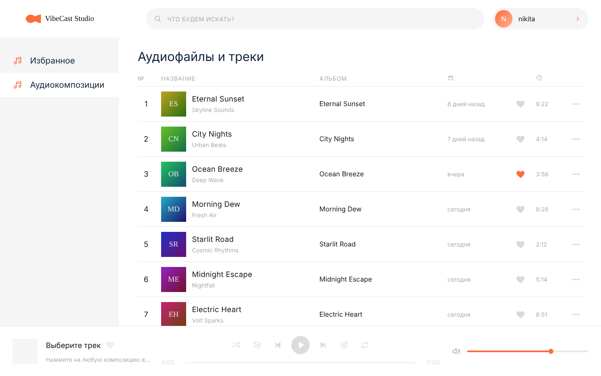
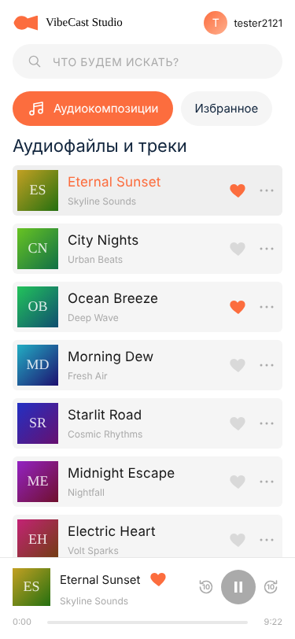

# VibeCast Studio — аудиоплеер

Клиентская часть аудиоплеера на TypeScript: регистрация и вход, каталог треков с поиском и пагинацией, избранное, профиль и полноценный плеер с очередью воспроизведения. Интерфейс собран по макету VibeCast Studio, адаптирован под десктоп, планшет и телефон.

 

## Возможности

**Плеер**
- воспроизведение и пауза, предыдущий и следующий трек;
- перемотка на ±10 секунд: кнопками, стрелками ← → или колесом мыши над шкалой;
- перемотка кликом по любому месту временной шкалы;
- режимы «перемешать» и «повтор» (выключен → весь список → один трек);
- громкость с запоминанием между сессиями, быстрый mute;
- горячие клавиши: `Пробел` — пауза, `←/→` — ±10 с, `Shift + ←/→` — соседний трек.

**Каталог и навигация**
- список треков с классической пагинацией на десктопе и ленивой подгрузкой при прокрутке на телефоне;
- поиск по названию и исполнителю без лишних запросов к серверу;
- избранное: сердечко в строке, в карточке трека и в плеере, состояние синхронизировано везде;
- карточка трека с длительностью, размером и действиями;
- колонки как в макете: альбом и дата добавления;
- профиль с аватаром-заглушкой и статистикой избранного;
- регистрация и вход с проверкой полей, автоматический выход при истёкшем токене.

## Стек

- **TypeScript** в строгом режиме, без `any`;
- **RE:DOM** — создание элементов и обновление списков без ручной работы с DOM. Выбран, потому что он лёгкий (около 2 КБ), не навязывает архитектуру и хорошо сочетается с классовыми компонентами;
- **Vite** — сборка и dev-сервер с прокси на API;
- **ESLint** + `typescript-eslint` (strict);
- чистый CSS с методологией **БЭМ**, адаптивность на CSS Grid и медиазапросах.

## Архитектура

```
src/
├── api/            # запросы к серверу: обёртка над fetch и методы API
├── core/           # состояние без привязки к интерфейсу
│   ├── session.ts  #   токен и имя пользователя
│   ├── history.ts  #   даты добавления треков в localStorage
│   ├── library.ts  #   кэш треков и избранного
│   ├── player.ts   #   очередь, воспроизведение, режимы
│   ├── router.ts   #   hash-роутер
│   ├── synth.ts    #   генерация звука для треков
│   └── emitter.ts  #   типизированные события
├── components/     # переиспользуемые части интерфейса
├── pages/          # экраны входа и профиля
├── utils/          # форматирование и хелперы
├── styles/         # стили по БЭМ
├── app.ts          # корневой компонент: связывает экраны с состоянием
└── main.ts         # точка входа
```

Интерфейс не хранит состояние сам: компоненты подписываются на события `session`, `library` и `player` и только отрисовывают изменения. Поэтому, например, сердечко в списке, в карточке и в плеере всегда показывает одно и то же.

**Запросы к серверу.** Треки и избранное загружаются один раз за сессию. Поиск, пагинация и переключение разделов работают с кэшем. Добавление в избранное оптимистичное: интерфейс меняется сразу, а при ошибке сервера откатывается и показывает уведомление.

**Звук.** Учебный API вместо аудиофайлов отдаёт текстовую заглушку (`encoded_audio`). Чтобы плеер работал по-настоящему, для каждого трека на клиенте генерируется своя мелодия ровно той длительности, что указана в API. Файл создаётся при первом запуске трека и кэшируется.

**Данные, которых нет в API.** Сервер не отдаёт обложки, альбом и дату добавления, а в макете они есть. Колонки сохранены, данные для них берутся так:
- обложка — градиентная заглушка с инициалами трека, цвет у каждого трека свой и не меняется;
- альбом — трек считается синглом, поэтому альбом совпадает с названием;
- дата — клиент сам запоминает в `localStorage` (отдельно для каждого пользователя), когда трек появился в медиатеке и когда попал в избранное, и показывает её как в макете: «сегодня», «вчера», «6 дней назад».

Размер файла показан в карточке трека.

## Запуск

Нужен Node.js 18+ и учебный бэкенд `express-backend`.

1. Запустите бэкенд (порт 8000):
   ```bash
   cd express-backend
   npm install
   npm start
   ```
2. Запустите клиент:
   ```bash
   npm install
   npm run dev
   ```
3. Откройте http://localhost:5173, зарегистрируйтесь и войдите.

Бэкенд не отдаёт CORS-заголовки, поэтому dev-сервер Vite проксирует запросы `/api` на `http://localhost:8000` (см. `vite.config.ts`).

Учтите: бэкенд хранит пользователей в памяти, поэтому после его перезапуска нужно зарегистрироваться заново.

## Скрипты

| Команда | Что делает |
| --- | --- |
| `npm run dev` | dev-сервер с горячей перезагрузкой |
| `npm run build` | проверка типов и продакшн-сборка в `dist/` |
| `npm run preview` | просмотр собранной версии |
| `npm run lint` | проверка кода ESLint |
| `npm run typecheck` | проверка типов без сборки |
